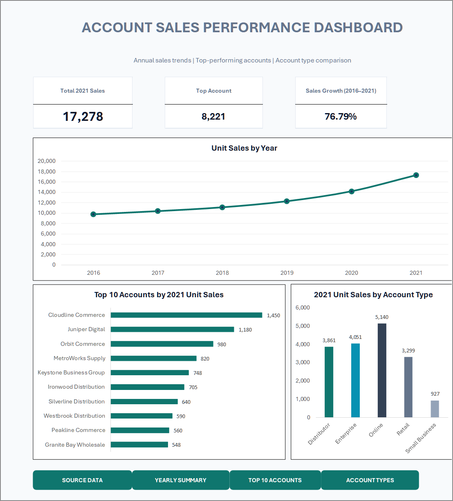
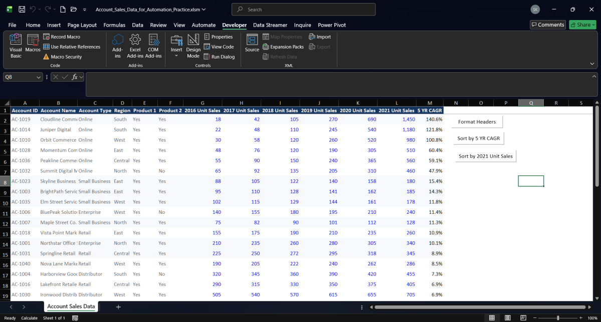
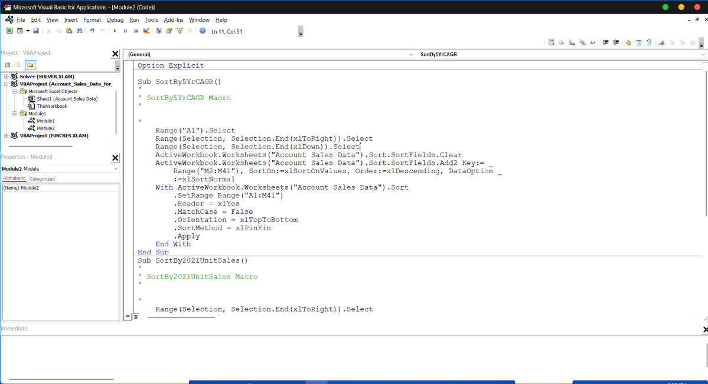

<div align="center">

# Excel Skills — Forage Job Simulation

<p>
  <a href="https://www.theforage.com/simulations/forage/sponsored-content-excel-skills-jf8r">
    
  </a>
  
  
  
</p>

<p>
  <a href="https://github.com/Sohila-Khaled-Abbas/forage-excel-skills-job-simulation/commits/main">
    
  </a>
  <a href="https://github.com/Sohila-Khaled-Abbas/forage-excel-skills-job-simulation">
    
  </a>
  <a href="https://github.com/Sohila-Khaled-Abbas/forage-excel-skills-job-simulation/stargazers">
    
  </a>
</p>

**A comprehensive, hands-on Excel learning portfolio demonstrating data preparation, advanced conditional formatting, dynamic formulas, executive dashboard visualization, and VBA spreadsheet automation.**

[Simulation Brief](https://www.theforage.com/simulations/forage/sponsored-content-excel-skills-jf8r) · [Completion Certificate](https://www.theforage.com/completion-certificates/HgpPSsyQpzob6HEh9/SfGxkQ8FacaZR9LnZ_HgpPSsyQpzob6HEh9_6ae9f5fbcfb5bb576b61ccb2_1793821202129_completion_certificate.pdf) · [Learning Log](LEARNING_LOG.md) · [Repository Files](https://github.com/Sohila-Khaled-Abbas/forage-excel-skills-job-simulation/tree/main)

</div>

---

## 📊 Visual Showcase & Executive Deliverables

### 1. Executive Account Sales Performance Dashboard (Task 03)
<div align="center">
  <a href="screenshots/03-account-sales-performance-dashboard.png">
    
  </a>
  <p><em>Figure 1: High-impact executive dashboard built in Microsoft Excel featuring synchronized KPI cards, multi-year sales trends, top-10 account rankings, business segment breakdown, and custom navigation controls.</em></p>
</div>

### 2. VBA Automation & Form Control Macro Buttons (Task 04)
<div align="center">
  <a href="screenshots/04-sorting-macro-buttons-worksheet.png">
    
  </a>
  <p><em>Figure 2: Form Control command buttons (<code>Format Headers</code>, <code>Sort by 5 YR CAGR</code>, <code>Sort by 2021 Unit Sales</code>) integrated directly into the Account Sales Data worksheet for one-click execution.</em></p>
</div>

<div align="center">
  <a href="screenshots/04-vba-sorting-macro-code.png">
    
  </a>
  <p><em>Figure 3: Microsoft Visual Basic for Applications (VBA) editor showing the recorded macro procedures (<code>SortBy5YrCAGR</code> and <code>SortBy2021UnitSales</code>) in Module2.</em></p>
</div>

---

> [!NOTE]
> This is an independent learning portfolio created to document my participation, problem-solving, and practical execution. It is **not** an official Forage repository and does not imply employment, sponsorship, or endorsement by Forage.

## Contents

- [Program Overview](#program-overview)
- [Learning Roadmap](#learning-roadmap)
- [Task 01 — Conditional Formatting & Data Quality](#task-01--conditional-formatting--data-quality)
- [Task 02 — Formulas, Logic & Aggregation](#task-02--formulas-logic--aggregation)
- [Task 03 — Executive Charts & Interactive Dashboard](#task-03--executive-charts--interactive-dashboard)
- [Task 04 — Spreadsheet Automation & VBA Macros](#task-04--spreadsheet-automation--vba-macros)
- [Advanced App-Style Design & Office Scripts](#advanced-app-style-design--office-scripts)
- [Repository Structure](#repository-structure)
- [Analysis Workflow & Standards](#analysis-workflow--standards)
- [Key Competencies](#key-competencies)
- [Verification & Progress](#verification--progress)

---

## Program Overview

| Detail | Description |
|---|---|
| **Provider** | Forage Academy |
| **Simulation** | Excel Skills Virtual Experience Program |
| **Format** | Self-paced, practical job simulation with real-world scenarios |
| **Primary Tools** | Microsoft Excel (Desktop & Web), VBA, Office Scripts (TypeScript) |
| **Portfolio Status** |  |
| **Completion Date** | **November 4, 2026** |
| **Official Brief** | [Open the Forage simulation](https://www.theforage.com/simulations/forage/sponsored-content-excel-skills-jf8r) |
| **Verified Credential** | [Download Forage Completion Certificate (PDF)](https://www.theforage.com/completion-certificates/HgpPSsyQpzob6HEh9/SfGxkQ8FacaZR9LnZ_HgpPSsyQpzob6HEh9_6ae9f5fbcfb5bb576b61ccb2_1793821202129_completion_certificate.pdf) |

The simulation was completed and officially submitted on **November 4, 2026**. This repository elevates each practical simulation exercise into an industry-standard, reviewable portfolio artifact documenting the analytical reasoning, formula logic, visual design choices, and VBA automation workflows.

---

## Learning Roadmap


| Domain | Analytical Focus | Documentation & Notes |
|---|---|---|
| **Workbook Navigation & Inspection** | Table architecture, data types, header alignment, keyboard shortcuts | [Excel Keyboard Shortcuts](docs/Excel%20Keyboard%20Shortcuts.docx) |
| **Data Quality & Cleansing** | Missing values, formula error strings, edge cases, cross-sell gaps | [Data Preparation Notes](learning-notes/data-preparation.md) |
| **Formulas & Business Logic** | Dynamic lookups, conditional thresholds, percentage growth, error handling | [Formulas & Analysis](learning-notes/formulas-and-analysis.md) |
| **Charts & Dashboard Design** | Trend analysis, ranking charts, category comparisons, KPI scorecards | [Charts & Dashboards](learning-notes/charts-and-dashboards.md) |
| **Spreadsheet Automation** | Macro recording, VBA code optimization, Form Control button bindings | [Automation & VBA](learning-notes/automation-and-vba.md) |
| **Critical Reflection** | Methodological insights, limitations, business impact, scalability | [Reflection Notes](learning-notes/reflection.md) |

---

## Task 01 — Conditional Formatting & Data Quality

<details open>
<summary><strong>Task 01 — Put Conditional Formatting Into Practice</strong> · </summary>

The first exercise applied six conditional formatting rules to the **Account Sales Data** dataset (`A2:M41`, 40 account records) to surface data anomalies, missing entries, product adoption gaps, and exceptional performance tiers.

**Workbooks:**
- [Original Practice Workbook](material/01-conditional-formatting/Account%20Sales%20Data%20for%20Analysis.xlsx)
- [Completed Analysis Workbook](material/01-conditional-formatting/Account_Sales_Data_Analysis_Completed.xlsx)

**Detailed Documentation:** [Task 01 — Conditional Formatting Findings](docs/01-conditional-formatting-findings.md)

### Key Analytical Findings

| Finding | Quantified Result | Business Significance |
|---|---:|---|
| Total Accounts Analyzed | 40 | Base population for enterprise sales performance |
| Missing / Blank Cells | 5 cells | Data entry gaps requiring audit (D6, C12, E21, F29, D35) |
| Text `Formula Error` Markers | 2 accounts | M9 (Summit Ridge Retail) & M27 (Apex Commercial) |
| Product 2 Not Cross-Sold | 16 accounts | Untapped 40% expansion opportunity across current accounts |
| High CAGR (Numeric ≥ 100%) | 3 accounts | Cloudline Commerce (140.6%), Juniper Digital (121.8%), Orbit Commerce (100.8%) |
| Negative Growth Rate | 7 accounts | At-risk accounts experiencing contraction over the 5-year span |
| Top Decile 2021 Volume | 4 accounts | Top 10% volume drivers (≥ 820 units in 2021) |

### Conditional Formatting Rules Architecture

```text
Priority 1: Text & Formula Errors  ──> [Purple Fill / White Font] (Applies to A2:M41)
Priority 2: Missing Data (Blanks)   ──> [Yellow Fill]               (Applies to A2:M41)
Priority 3: Product 2 = "No"       ──> [Orange Fill]               (Applies to F2:F41)
Priority 4: 5 YR CAGR ≥ 100%       ──> [Green Fill]                (Applies to M2:M41, ISNUMBER check)
Priority 5: 5 YR CAGR < 0%         ──> [Red Fill / White Font]     (Applies to M2:M41)
Priority 6: Top 10% 2021 Sales     ──> [Blue Fill]                 (Applies to L2:L41)
```

> [!TIP]
> The CAGR condition specifically utilizes `=AND(ISNUMBER(M2), M2>=1)` rather than a simple greater-than test. In Excel's internal evaluation, text strings evaluate as greater than any number; without the `ISNUMBER` safeguard, rows containing the text string `"Formula Error"` would be falsely highlighted green as high-growth accounts.

</details>

---

## Task 02 — Formulas, Logic & Aggregation

<details open>
<summary><strong>Task 02 — Put Formulas Into Practice</strong> · </summary>

Task 02 engineered account-level performance indicators and global portfolio summary calculations across annual sales data from 2016 through 2021.

**Workbooks:**
- [Original Practice Workbook](material/02-formulas-and-functions/Excel_Formula_Practice.xlsx)
- [Completed Calculations Workbook](material/02-formulas-and-functions/Excel_Formula_Practice_Completed.xlsx)

**Detailed Documentation:** [Task 02 — Formulas and Functions Findings](docs/02-formulas-and-functions-findings.md)

### Account-Level Dynamic Calculations

| Metric | Excel Formula | Calculation Purpose |
|---|---|---|
| **Total Unit Sales** | `=SUM(G2:L2)` | Cumulative volume generated from 2016 to 2021 |
| **Average Annual Sales** | `=AVERAGE(G2:L2)` | Six-year normalized run-rate per account |
| **Peak Sales Volume** | `=MAX(G2:L2)` | Single best historical annual performance |
| **Trough Sales Volume** | `=MIN(G2:L2)` | Lowest annual volume baseline |
| **Sales Tier Classification** | `=IF(L2>=$U$2,"High","Standard")` | Absolute threshold comparison against cell `$U$2` (500 units) |
| **6-Year Sales Growth** | `=IFERROR((L2-G2)/G2,"Check data")` | Normalized delta with robust handling for zero/blank baselines |

### Portfolio Summary Calculations

| Metric | Excel Formula | Result | Purpose |
|---|---|---:|---|
| **Cross-Sold Accounts (Product 2)** | `=COUNTIF(F2:F41,"Yes")` | 23 accounts | Measures core product cross-sell penetration (57.5%) |
| **Retail Segment 2021 Volume** | `=SUMIF(C2:C41,"Retail",L2:L41)` | 3,299 units | Aggregates volume for the retail sector |

</details>

---

## Task 03 — Executive Charts & Interactive Dashboard

<details open>
<summary><strong>Task 03 — Prepare Your Data for Visualization</strong> · </summary>

The Task 03 objective was to convert raw tabular account data into an executive-ready performance dashboard comprising KPI cards, multi-year trend visuals, segment breakdowns, and account rankings.

**Workbooks & Assets:**
- [Final Working Dashboard Workbook (XLSX)](material/03-build-charts-and-dashboards/Account_Sales_Data_for_Dashboard_Practice_Working.xlsx)
- [Enhanced App-Style Workbook (XLSM)](material/03-build-charts-and-dashboards/Account_Sales_Dashboard_AppStyle.xlsm)
- [Exported Dashboard Presentation (PDF)](material/03-build-charts-and-dashboards/Dashboard_Dashboard_20261104_221720.pdf)
- [Executive Dashboard Visual (PNG)](screenshots/03-account-sales-performance-dashboard.png)

**Guides & Detailed Notes:**
- [Task 03 — Charts and Dashboard Preparation](docs/03-chart-and-dashboard-preparation.md)
- [Dashboard Design & Advanced Formatting Guide](docs/04-dashboard-advanced-formatting-and-vba.md)

### Executive Dashboard Architecture

```text
┌────────────────────────────────────────────────────────────────────────┐
│                   ACCOUNT SALES PERFORMANCE DASHBOARD                  │
│       Annual sales trends | Top-performing accounts | Account type     │
├────────────────────┬────────────────────┬──────────────────────────────┤
│  Total 2021 Sales  │    Top Account     │   Sales Growth (2016-2021)   │
│       17,278       │       8,221        │            76.79%            │
├────────────────────┴────────────────────┴──────────────────────────────┤
│                          Unit Sales by Year                            │
│  [Multi-year trend line: 9,773 (2016)  ──>  17,278 (2021)]             │
├─────────────────────────────────────────┬──────────────────────────────┤
│   Top 10 Accounts by 2021 Unit Sales    │ 2021 Unit Sales by Acct Type │
│   [Horizontal ranking bar chart]        │ [Vertical column comparison] │
├─────────────────────────────────────────┴──────────────────────────────┤
│ [SOURCE DATA]   [YEARLY SUMMARY]   [TOP 10 ACCOUNTS]   [ACCOUNT TYPES] │
└────────────────────────────────────────────────────────────────────────┘
```

### KPI Cards & Performance Metrics

| KPI Scorecard | Displayed Metric | Underlying Source / Logic |
|---|---:|---|
| **Total 2021 Sales** | **17,278** units | Grand total of 2021 unit sales across all 40 accounts |
| **Top Account (Top 10 Volume)** | **8,221** units | Combined sales volume contributed by the Top 10 accounts (47.6% of portfolio) |
| **Sales Growth (2016–2021)** | **76.79%** | Multi-year portfolio growth `=('Annual_Sales_Summary'!$B$7-$B$2)/$B$2` (+7,505 units) |

### Supporting Visual Components

1. **Unit Sales by Year (Line Chart):**
   - Source: `Annual_Sales_Summary` table (2016: 9,773; 2017: 10,380; 2018: 11,115; 2019: 12,283; 2020: 14,193; 2021: 17,278).
   - Demonstrates steady year-over-year acceleration, peaking at 17,278 units in 2021.
2. **Top 10 Accounts by 2021 Unit Sales (Horizontal Bar Chart):**
   - Source: `PT_Top10_2021` PivotTable.
   - Cloudline Commerce leads at **1,450 units**, followed by Juniper Digital (**1,180 units**) and Orbit Commerce (**980 units**).
3. **2021 Unit Sales by Account Type (Column Chart):**
   - Source: `PT_Sales_by_Type` PivotTable.
   - **Online** represents the largest single segment at **5,140 units**, followed by Enterprise (**4,051 units**), Distributor (**3,861 units**), Retail (**3,299 units**), and Small Business (**927 units**).

</details>

---

## Task 04 — Spreadsheet Automation & VBA Macros

<details open>
<summary><strong>Task 04 — Record, Sort, and Automate with Macros</strong> · </summary>

Task 04 introduced spreadsheet automation using Excel's Macro Recorder, Visual Basic for Applications (VBA), and worksheet Form Controls to eliminate manual, error-prone data sorting and formatting tasks.

**Workbooks & Evidence:**
- [Clean Automation Workbook (XLSX)](material/04-vba-and-marcos/Account_Sales_Data_for_Automation.xlsx)
- [Macro-Enabled Working Workbook (XLSM)](material/04-vba-and-marcos/Account_Sales_Data_for_Automation_Practice.xlsm)
- [Task 04 Evidence Document (PDF)](material/04-vba-and-marcos/Task_04_Macro_Buttons_Evidence.pdf)
- [Worksheet Macro Buttons Screenshot (PNG)](screenshots/04-sorting-macro-buttons-worksheet.png)
- [VBA Code Window Screenshot (PNG)](screenshots/04-vba-sorting-macro-code.png)

**Guides & Detailed Notes:**
- [Task 04 — Record and Run a Macro](docs/05-record-and-run-a-macro.md)
- [Task 04 — Sorting Macros and Buttons](docs/06-sort-macros-and-buttons.md)

### Implemented Macros & Controls

Three Form Control buttons were created and placed cleanly in column `Q` (`Q2:Q8`) adjacent to the main data table:

| Button Label | Bound Procedure | Code Module | Operation Performed |
|---|---|---|---|
| `[Format Headers]` | `FormatSalesHeaders` | `Module1` | Applies bold font, centered alignment, and professional formatting to the header row `A1:M1` |
| `[Sort by 5 YR CAGR]` | `SortBy5YrCAGR` | `Module2` | Dynamically selects `A1:M41` and sorts descending on column `M` (`5 YR CAGR`) |
| `[Sort by 2021 Unit Sales]` | `SortBy2021UnitSales` | `Module2` | Dynamically selects `A1:M41` and sorts descending on column `L` (`2021 Unit Sales`) |

### Verified VBA Implementation (`Module2`)

```vba
Option Explicit

Sub SortBy5YrCAGR()
'
' SortBy5YrCAGR Macro
'
    Range("A1").Select
    Range(Selection, Selection.End(xlToRight)).Select
    Range(Selection, Selection.End(xlDown)).Select
    ActiveWorkbook.Worksheets("Account Sales Data").Sort.SortFields.Clear
    ActiveWorkbook.Worksheets("Account Sales Data").Sort.SortFields.Add2 Key:= _
        Range("M2:M41"), SortOn:=xlSortOnValues, Order:=xlDescending, DataOption _
        :=xlSortNormal
    With ActiveWorkbook.Worksheets("Account Sales Data").Sort
        .SetRange Range("A1:M41")
        .Header = xlYes
        .MatchCase = False
        .Orientation = xlTopToBottom
        .SortMethod = xlPinYin
        .Apply
    End With
End Sub

Sub SortBy2021UnitSales()
'
' SortBy2021UnitSales Macro
'
    Range("A1").Select
    Range(Selection, Selection.End(xlToRight)).Select
    Range(Selection, Selection.End(xlDown)).Select
    ActiveWorkbook.Worksheets("Account Sales Data").Sort.SortFields.Clear
    ActiveWorkbook.Worksheets("Account Sales Data").Sort.SortFields.Add2 Key:= _
        Range("L2:L41"), SortOn:=xlSortOnValues, Order:=xlDescending, DataOption _
        :=xlSortNormal
    With ActiveWorkbook.Worksheets("Account Sales Data").Sort
        .SetRange Range("A1:M41")
        .Header = xlYes
        .MatchCase = False
        .Orientation = xlTopToBottom
        .SortMethod = xlPinYin
        .Apply
    End With
End Sub
```

> [!IMPORTANT]
> Both macros preserve the entire tabular grain (`A1:M41`) during the sort, ensuring that columns are never sorted in isolation, thereby maintaining perfect row-level relational integrity across all 40 account records.

</details>

---

## Advanced App-Style Design & Office Scripts

To bridge traditional desktop spreadsheet design with modern cloud web applications, the project incorporates:

1. **Desktop VBA Module (`DashboardAppStyle.bas`):**
   - Applies an app-inspired design system with an off-white canvas (`#F8FAFC`), deep navy typography (`#0F172A`), card surface containers (`#FFFFFF`), and refined borders (`#E2E8F0`).
   - Automatically builds 4 interactive worksheet navigation buttons docking below the visuals.
   - Includes `RestoreDashboardEditView` to restore row/column headings and gridlines for formula auditing.
2. **Web-Native Office Scripts (`DashboardAppStyle_Web.ts` & `RestoreDashboardEditView_Web.ts`):**
   - Authoring automation in modern TypeScript compatible with **Excel for the Web**.
   - Leverages `ExcelScript.Range` and `ExcelScript.Chart` APIs for cross-platform cloud execution.

---

## Repository Structure

```text
forage-excel-skills-job-simulation/
├── README.md                                          # Master repository documentation
├── LEARNING_LOG.md                                    # Chronological development & audit log
├── .gitignore                                         # Git ignore configuration
│
├── screenshots/                                       # High-resolution visual evidence
│   ├── 03-account-sales-performance-dashboard.png     # Rendered executive dashboard
│   ├── 04-sorting-macro-buttons-worksheet.png         # Form control buttons on data table
│   └── 04-vba-sorting-macro-code.png                  # VBA code editor with sort procedures
│
├── docs/                                              # Technical guides & analytical findings
│   ├── 01-conditional-formatting-findings.md          # Task 01 findings & rule specifications
│   ├── 02-formulas-and-functions-findings.md          # Task 02 formula logic & summary stats
│   ├── 03-chart-and-dashboard-preparation.md          # Task 03 data modeling & visual design
│   ├── 04-dashboard-advanced-formatting-and-vba.md    # Modern app styling & navigation code
│   ├── 05-record-and-run-a-macro.md                   # Task 04 macro recording foundations
│   ├── 06-sort-macros-and-buttons.md                  # Task 04 multi-key sorting & Form Controls
│   ├── Excel Keyboard Shortcuts.docx                  # Keyboard shortcut reference guide
│   └── Excel Formula Quick Reference Guide.docx       # Formula syntax cheat sheet
│
├── learning-notes/                                    # Pedagogical reflections & deep dives
│   ├── data-preparation.md                            # Data quality auditing principles
│   ├── formulas-and-analysis.md                       # Dynamic calculation architecture
│   ├── charts-and-dashboards.md                       # Dashboard UX & cognitive load principles
│   ├── automation-and-vba.md                          # Macro recorder mechanics & VBA best practices
│   └── reflection.md                                  # End-of-simulation analyst retrospective
│
└── material/                                          # Practice workbooks & deliverables
    ├── 01-conditional-formatting/
    │   ├── Account Sales Data for Analysis.xlsx       # Original practice file
    │   └── Account_Sales_Data_Analysis_Completed.xlsx # Completed formatted workbook
    ├── 02-formulas-and-functions/
    │   ├── Excel_Formula_Practice.xlsx                # Original practice file
    │   └── Excel_Formula_Practice_Completed.xlsx      # Completed formulas workbook
    ├── 03-build-charts-and-dashboards/
    │   ├── Account_Sales_Data_for_Dashboard_Practice.xlsx # Original practice file
    │   ├── Account_Sales_Data_for_Dashboard_Practice_Working.xlsx # Master XLSX dashboard
    │   ├── Account_Sales_Dashboard_AppStyle.xlsm      # Macro-enabled app-styled dashboard
    │   ├── Dashboard_Dashboard_20261104_221720.pdf   # Exported executive dashboard PDF
    │   ├── DashboardAppStyle.bas                      # Reusable VBA styling module
    │   ├── DashboardAppStyle_Web.ts                   # Office Scripts web styling (TypeScript)
    │   └── RestoreDashboardEditView_Web.ts            # Office Scripts view reset (TypeScript)
    └── 04-vba-and-marcos/
        ├── Account_Sales_Data_for_Automation.xlsx     # Original practice file
        ├── Account_Sales_Data_for_Automation_Practice.xlsm # Macro-enabled automation workbook
        └── Task_04_Macro_Buttons_Evidence.pdf         # Official PDF evidence submission
```

---

## Analysis Workflow & Standards

1. **Verify Source Integrity:** Keep raw files untouched; conduct all modeling in designated working copies.
2. **Strict Range Isolation:** Use explicit range definitions and structured references (`AccountSales[...]`) to avoid off-by-one errors.
3. **Defensive Formula Engineering:** Shield calculations against edge cases using `IFERROR`, `ISNUMBER`, and absolute anchors (`$`).
4. **Cognitive Load Optimization:** Limit dashboards to 3–4 high-signal visuals with consistent typography, muted palettes, and clear visual hierarchy.
5. **Auditable Code Quality:** Maintain clean modular VBA procedures with `Option Explicit`, clear scoping, and zero data-loss side effects.

---

## Key Competencies

<p>
  
  
  
  
  
  
</p>

---

## Verification & Progress

- [x] **Task 01:** Conditional formatting applied across 6 rules; verified against 40 records.
- [x] **Task 02:** Summary and row-level formulas implemented and audited.
- [x] **Task 03:** Excel Table, PivotTables, 3 charts, 3 KPI cards, and dashboard assembled and exported.
- [x] **Task 04:** Form Control buttons (`Format Headers`, `Sort by 5 YR CAGR`, `Sort by 2021 Unit Sales`) created, tested, and submitted.
- [x] **Evidence Verification:** Official PDF evidence (`Task_04_Macro_Buttons_Evidence.pdf`) and Dashboard PDF (`Dashboard_Dashboard_20261104_221720.pdf`) inspected, verified, and documented.
- [x] **Official Completion:** Simulation submitted; Forage certificate awarded on **November 4, 2026**.

---

<div align="center">

**Rigorous spreadsheet engineering. Professional visual analytics. Repeatable business automation.**

[Forage Academy](https://www.theforage.com/) · [Back to Top](#excel-skills--forage-job-simulation)

</div>
