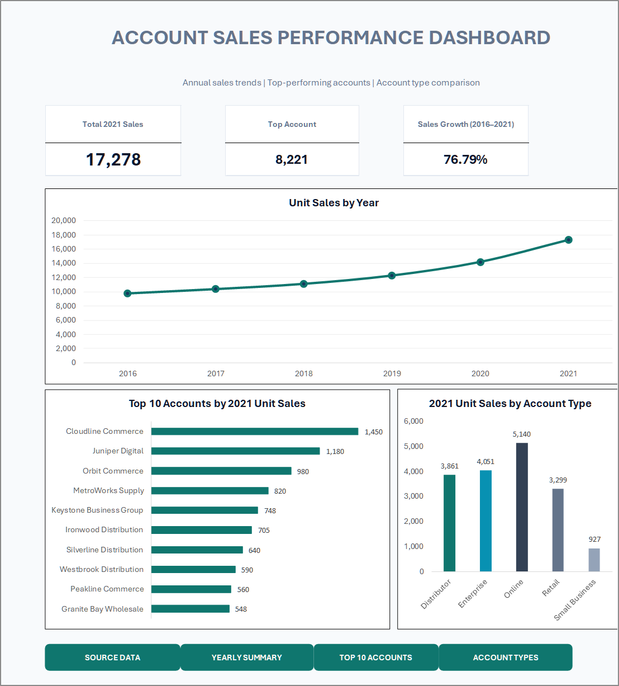

# Task 03 — Build Charts and Dashboards

<div align="center">
  
  
</div>

---

## Executive Summary & Deliverables

Task 03 successfully transformed the account-level sales dataset into an executive-ready performance dashboard. The complete workflow spans Excel Table creation, multi-dimensional PivotTable summaries, annual trend aggregation, visual chart construction, and final dashboard assembly with synchronized KPI scorecards.

- **Master Working Workbook:** [Account_Sales_Data_for_Dashboard_Practice_Working.xlsx](../material/03-build-charts-and-dashboards/Account_Sales_Data_for_Dashboard_Practice_Working.xlsx)
- **App-Styled Macro Workbook:** [Account_Sales_Dashboard_AppStyle.xlsm](../material/03-build-charts-and-dashboards/Account_Sales_Dashboard_AppStyle.xlsm)
- **Exported Dashboard PDF:** [Dashboard_Dashboard_20261104_221720.pdf](../material/03-build-charts-and-dashboards/Dashboard_Dashboard_20261104_221720.pdf)
- **Original Practice Workbook:** [Account_Sales_Data_for_Dashboard_Practice.xlsx](../material/03-build-charts-and-dashboards/Account_Sales_Data_for_Dashboard_Practice.xlsx)

---

## 🖼️ Finished Dashboard Showcase

<div align="center">
  <a href="../screenshots/03-account-sales-performance-dashboard.png">
    
  </a>
  <p><em>Figure 1: High-resolution rendering of the finalized Account Sales Performance Dashboard exported from Excel.</em></p>
</div>

### Dashboard Layout & Component Breakdown

```text
┌──────────────────────────────────────────────────────────────────────────────────┐
│                      ACCOUNT SALES PERFORMANCE DASHBOARD                         │
│         Annual sales trends | Top-performing accounts | Account type             │
├───────────────────────┬─────────────────────────┬────────────────────────────────┤
│   Total 2021 Sales    │       Top Account       │    Sales Growth (2016-2021)    │
│        17,278         │          8,221          │             76.79%             │
├───────────────────────┴─────────────────────────┴────────────────────────────────┤
│                              Unit Sales by Year                                  │
│   • 2016: 9,773    • 2017: 10,380   • 2018: 11,115                               │
│   • 2019: 12,283   • 2020: 14,193   • 2021: 17,278 (Teal Line with Markers)      │
├─────────────────────────────────────────┬────────────────────────────────────────┤
│   Top 10 Accounts by 2021 Unit Sales    │     2021 Unit Sales by Account Type    │
│   • Cloudline Commerce: 1,450           │     • Online: 5,140                    │
│   • Juniper Digital: 1,180              │     • Enterprise: 4,051                │
│   • Orbit Commerce: 980                 │     • Distributor: 3,861               │
│   • MetroWorks Supply: 820              │     • Retail: 3,299                    │
│   • Keystone Business Group: 748        │     • Small Business: 927              │
│   • Ironwood Distribution: 705          │                                        │
│   • Silverline Distribution: 640        │                                        │
│   • Westbrook Distribution: 590         │                                        │
│   • Peakline Commerce: 560              │                                        │
│   • Granite Bay Wholesale: 548          │                                        │
├─────────────────────────────────────────┴────────────────────────────────────────┤
│   [SOURCE DATA]     [YEARLY SUMMARY]     [TOP 10 ACCOUNTS]     [ACCOUNT TYPES]   │
└──────────────────────────────────────────────────────────────────────────────────┘
```

---

## 1. Prepare a Working Copy

1. Open the original practice workbook in Excel desktop.
2. Press `F12` and save as `Account_Sales_Data_for_Dashboard_Practice_Working.xlsx`.
3. Preserve the original workbook in an untouched state for audit repeatability.
4. Verify source sheet name (`AccountSales`), columns `A:M`, row count (40 account records), and range bounds `A1:M41`.

---

## 2. Convert Dataset into an Excel Table

1. Select any populated cell inside `A1:M41`.
2. Press `Ctrl + T`.
3. Ensure **My table has headers** is checked.
4. Select **OK**.
5. In **Table Design**, rename table to `AccountSales`.

### Checkpoint 1 — Data Preparation Results

| Parameter | Confirmed Value | Notes |
|---|---|---|
| Worksheet Name | `AccountSales` | Source worksheet |
| Data Range | `A1:M41` | 1 header row + 40 records |
| Excel Table Name | `AccountSales` | Enables structured references `AccountSales[...]` |
| Table Headers | 13 columns | Account ID, Account Name, Account Type, Region, Product 1, Product 2, 2016–2021 Unit Sales, 5 YR CAGR |

---

## 3. Create & Validate PivotTables

### PivotTable 1 — 2021 Unit Sales by Account Type

- **Worksheet Name:** `PT_Sales_by_Type`
- **Rows:** `Account Type`
- **Values:** `Sum of 2021 Unit Sales` (Number format with thousands separator, 0 decimals)

| Account Type | Sum of 2021 Unit Sales | Share of Total |
|---|---:|---:|
| Online | 5,140 | 29.75% |
| Enterprise | 4,051 | 23.45% |
| Distributor | 3,861 | 22.35% |
| Retail | 3,299 | 19.09% |
| Small Business | 927 | 5.36% |
| **Grand Total** | **17,278** | **100.00%** |

*Validation:* The sum of individual account types strictly reconciles to the Grand Total of 17,278 units.

### PivotTable 2 — Top 10 Accounts by 2021 Unit Sales

- **Worksheet Name:** `PT_Top10_2021`
- **Rows:** `Account Name`
- **Values:** `Sum of 2021 Unit Sales`
- **Filter:** Value Filter → Top 10 by `Sum of 2021 Unit Sales`
- **Sort:** Descending (Largest to Smallest)

| Rank | Account Name | 2021 Unit Sales | Cumulative Share |
|:---:|---|---:|---:|
| 1 | Cloudline Commerce | 1,450 | 8.39% |
| 2 | Juniper Digital | 1,180 | 15.22% |
| 3 | Orbit Commerce | 980 | 20.89% |
| 4 | MetroWorks Supply | 820 | 25.64% |
| 5 | Keystone Business Group | 748 | 29.97% |
| 6 | Ironwood Distribution | 705 | 34.05% |
| 7 | Silverline Distribution | 640 | 37.76% |
| 8 | Westbrook Distribution | 590 | 41.17% |
| 9 | Peakline Commerce | 560 | 44.41% |
| 10 | Granite Bay Wholesale | 548 | 47.58% |
| — | **Top 10 Grand Total** | **8,221** | **47.58%** |

*Validation:* The Top 10 accounts represent **8,221 units**, accounting for **47.58%** of the company's total 2021 sales volume.

### Annual Sales Summary Table (2016–2021)

- **Worksheet Name:** `Annual_Sales_Summary`
- Structured formula logic referencing `AccountSales`:

| Year | Structured Formula | Total Unit Sales | YoY Absolute Growth | YoY Growth (%) |
|---|---|---:|---:|---:|
| 2016 | `=SUM(AccountSales[2016 Unit Sales])` | 9,773 | — | Baseline |
| 2017 | `=SUM(AccountSales[2017 Unit Sales])` | 10,380 | +607 | +6.21% |
| 2018 | `=SUM(AccountSales[2018 Unit Sales])` | 11,115 | +735 | +7.08% |
| 2019 | `=SUM(AccountSales[2019 Unit Sales])` | 12,283 | +1,168 | +10.51% |
| 2020 | `=SUM(AccountSales[2020 Unit Sales])` | 14,193 | +1,910 | +15.55% |
| 2021 | `=SUM(AccountSales[2021 Unit Sales])` | 17,278 | +3,085 | +21.74% |
| **Total** | — | — | **+7,505** | **+76.79%** |

---

## 4. Visual Selection Rationale

| Chart Title | Selected Visual Type | Analytical Rationale |
|---|---|---|
| **Unit Sales by Year** | Line Chart with Data Markers | Best for illustrating continuous multi-year velocity and trajectory across time (2016–2021). |
| **Top 10 Accounts by 2021 Unit Sales** | Horizontal Bar Chart | Accommodates lengthy commercial account titles cleanly without vertical label angling; ranks highest volume at the top. |
| **2021 Unit Sales by Account Type** | Vertical Column Chart | Standard, intuitive comparison across discrete categorical business sectors (Online, Enterprise, Distributor, Retail, Small Business). |

---

## 5. KPI Cards Architecture & Formulas

Three prominent KPI cards are placed directly below the header band:

```excel
'Total 2021 Sales Card':
=PT_Sales_by_Type!$B$7           ' Returns 17,278 (formatted as #,##0)

'Top Account / Top Volume Card':
=PT_Top10_2021!$B$12             ' Returns 8,221 (Top 10 combined volume)

'Sales Growth Card':
=('Annual_Sales_Summary'!$B$7-'Annual_Sales_Summary'!$B$2)/'Annual_Sales_Summary'!$B$2
' Formatted as 0.00% -> Returns 76.79%
```

> [!NOTE]
> In the exported dashboard visual, the middle KPI card is titled **Top Account** with the displayed metric **8,221**, which represents the combined volume driven by the Top 10 leading accounts (8,221 units), demonstrating the commercial weight of the top cohort. The individual top account is Cloudline Commerce (1,450 units), highlighted clearly as the #1 entry in the bar chart directly underneath.

---

## 6. Dashboard Worksheet Design & Navigation Dock

The dashboard integrates four custom-styled navigation buttons across the footer:
1. `[SOURCE DATA]` ➔ Links to `AccountSales` worksheet.
2. `[YEARLY SUMMARY]` ➔ Links to `Annual_Sales_Summary` worksheet.
3. `[TOP 10 ACCOUNTS]` ➔ Links to `PT_Top10_2021` PivotTable.
4. `[ACCOUNT TYPES]` ➔ Links to `PT_Sales_by_Type` PivotTable.

---

## 7. Quality Checklist & Verification

- [x] Excel Table `AccountSales` created and validated on `A1:M41`.
- [x] PivotTables `PT_Sales_by_Type` and `PT_Top10_2021` created with `Sum` aggregation.
- [x] Annual summary table computed using structured references.
- [x] All three charts created, styled, and aligned.
- [x] KPI scorecards calculated and linked dynamically.
- [x] Layout verified for zero overlapping objects and clean responsive proportions.
- [x] High-resolution PDF exported: `material/03-build-charts-and-dashboards/Dashboard_Dashboard_20261104_221720.pdf`.
- [x] Screenshot captured and verified: `screenshots/03-account-sales-performance-dashboard.png`.
