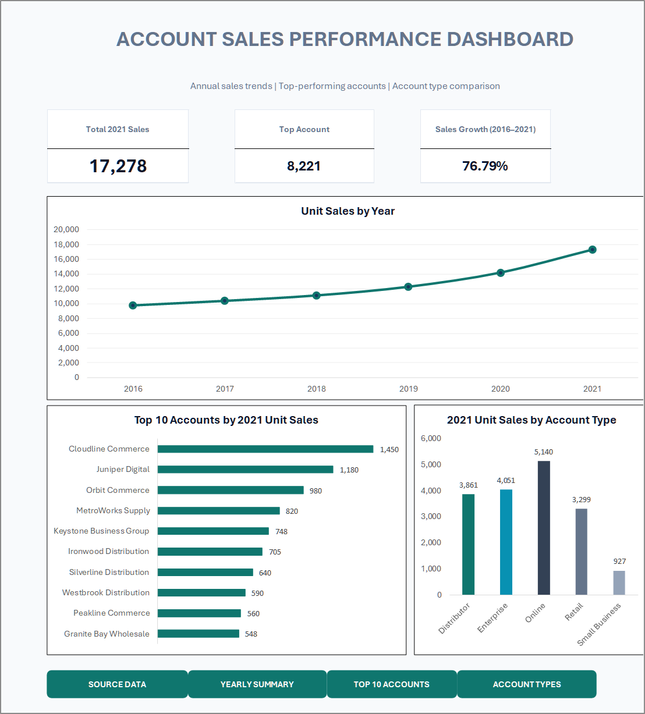

# Dashboard App-Style Formatting and VBA Enhancement

<div align="center">
  
  
  
</div>

---

## 🎨 Executive Dashboard Visual Showcase

<div align="center">
  <a href="../screenshots/03-account-sales-performance-dashboard.png">
    
  </a>
  <p><em>Figure 1: Final rendered layout generated by the presentation layer styling automation.</em></p>
</div>

---

## Purpose & Scope

This guide documents the implementation of an application-inspired presentation layer for Microsoft Excel dashboards. By replacing raw gridlines and ad-hoc chart formatting with a unified design system, typography hierarchy, card containers, and interactive navigation buttons, the workbook provides a modern, intuitive user experience.

### Companion Files

- **Master Macro Workbook:** [Account_Sales_Dashboard_AppStyle.xlsm](../material/03-build-charts-and-dashboards/Account_Sales_Dashboard_AppStyle.xlsm)
- **Exported Dashboard PDF:** [Dashboard_Dashboard_20261104_221720.pdf](../material/03-build-charts-and-dashboards/Dashboard_Dashboard_20261104_221720.pdf)
- **Desktop VBA Module:** [DashboardAppStyle.bas](../material/03-build-charts-and-dashboards/DashboardAppStyle.bas)
- **Web Office Script (Styling):** [DashboardAppStyle_Web.ts](../material/03-build-charts-and-dashboards/DashboardAppStyle_Web.ts)
- **Web Office Script (Reset View):** [RestoreDashboardEditView_Web.ts](../material/03-build-charts-and-dashboards/RestoreDashboardEditView_Web.ts)

---

## 1. Visual Design System

The layout adopts an intentional, restrained design system mirroring modern SaaS analytics dashboards:

| Design Token | Hex Code | Visual Application |
|---|---|---|
| **Canvas Background** | `#F8FAFC` | Main canvas surface providing soft contrast against white cards |
| **Primary Navy Text** | `#0F172A` | Dashboard header, KPI numerical values, chart titles |
| **Secondary Slate Text** | `#64748B` | Subtitles, KPI metric labels, axis descriptors |
| **Accent Deep Teal** | `#0F766E` | Line chart series, primary action buttons, data emphasis |
| **Card Surface** | `#FFFFFF` | Isolated rectangular panels for KPI scorecards and chart areas |
| **Border Stroke** | `#E2E8F0` | Subtle hairline container outlines preventing visual bleed |

### Typography Standards

- **Primary Font Family:** Aptos / Segoe UI / Aptos Display
- **Main Dashboard Header:** 22 pt, Bold, Deep Navy (`#0F172A`)
- **Subtitle Context:** 10 pt, Regular, Muted Slate (`#64748B`)
- **KPI Card Values:** 20 pt, Bold, Centered
- **KPI Card Headers:** 9 pt, Uppercase, Semi-Bold, Slate
- **Chart Titles:** 12 pt, Bold, Deep Navy

---

## 2. Dashboard Layout Grid

```text
┌────────────────────────────────────────────────────────────────────────┐
│ Range B2:N3  ──  Header Band: "ACCOUNT SALES PERFORMANCE DASHBOARD"    │
│ Range B4:N4  ──  Subtitle: "Annual sales trends | Top accounts | ..."  │
├────────────────────┬────────────────────┬──────────────────────────────┤
│ Card 1 (B6:D8)     │ Card 2 (F6:H8)     │ Card 3 (J6:L8)               │
│ Total 2021 Sales   │ Top Account        │ Sales Growth (2016-2021)     │
│ 17,278             │ 8,221              │ 76.79%                       │
├────────────────────┴────────────────────┴──────────────────────────────┤
│ Chart 1 (B10:N23)  ──  Unit Sales by Year (Line Chart)                 │
├─────────────────────────────────────────┬──────────────────────────────┤
│ Chart 2 (B25:H42)                       │ Chart 3 (J25:N42)            │
│ Top 10 Accounts by 2021 Unit Sales      │ 2021 Unit Sales by Acct Type │
│ (Horizontal Bar Chart)                  │ (Vertical Column Chart)      │
├─────────────────────────────────────────┴──────────────────────────────┤
│ Navigation Dock (B44:N46) ── Rounded Buttons:                          │
│ [SOURCE DATA]   [YEARLY SUMMARY]   [TOP 10 ACCOUNTS]   [ACCOUNT TYPES] │
└────────────────────────────────────────────────────────────────────────┘
```

---

## 3. Desktop VBA Implementation (`DashboardAppStyle.bas`)

The module `DashboardAppStyle.bas` automates the visual transformation directly in desktop Excel without altering formulas, data tables, or PivotTable definitions.

### Key Procedures

1. **`ApplyDashboardAppStyle()`**:
   - Disables screen updating for smooth execution (`Application.ScreenUpdating = False`).
   - Hides worksheet gridlines and headings on the `Dashboard` sheet.
   - Formats the header range (`B2:N3`) and subtitle (`B4:N4`).
   - Calls `FormatKpiCard()` for ranges `B6:D8`, `F6:H8`, and `J6:L8`.
   - Styles chart borders, fills, and text formats across all `ChartObjects`.
   - Builds or repositions 4 rounded navigation buttons below the charts with macro bindings.
2. **Navigation Procedures**:
   - `GoToAccountSales()` ➔ Activates `AccountSales` worksheet.
   - `GoToAnnualSummary()` ➔ Activates `Annual_Sales_Summary` worksheet.
   - `GoToTopAccounts()` ➔ Activates `PT_Top10_2021` worksheet.
   - `GoToAccountTypes()` ➔ Activates `PT_Sales_by_Type` worksheet.
   - `ReturnToDashboard()` ➔ Returns to `Dashboard`.
3. **`RestoreDashboardEditView()`**:
   - Re-enables gridlines, row/column headings, and resets zoom to 100% for normal formula auditing.

---

## 4. Web-Compatible Office Scripts (TypeScript)

For browser-based Excel workflows where desktop VBA is unsupported, native TypeScript Office Scripts are provided:

1. **`DashboardAppStyle_Web.ts`**:
   - Uses `ExcelScript.Worksheet.setShowGridlines(false)` and `setShowHeadings(false)`.
   - Formats ranges with `setPredefinedCellStyle()` or custom hex fill colors.
   - Converts navigation ranges into clean hyperlink cells pointing to internal sheets.
2. **`RestoreDashboardEditView_Web.ts`**:
   - Reverts headings and gridlines to visible for standard spreadsheet maintenance.

---

## 5. Verification Checklist

- [x] Master XLSX file preserved in its clean state.
- [x] App-style design tested and saved in `Account_Sales_Dashboard_AppStyle.xlsm`.
- [x] High-resolution visual verified in `screenshots/03-account-sales-performance-dashboard.png`.
- [x] PDF export generated and checked: `Dashboard_Dashboard_20261104_221720.pdf`.
- [x] Navigation buttons verified for accurate sheet routing.
