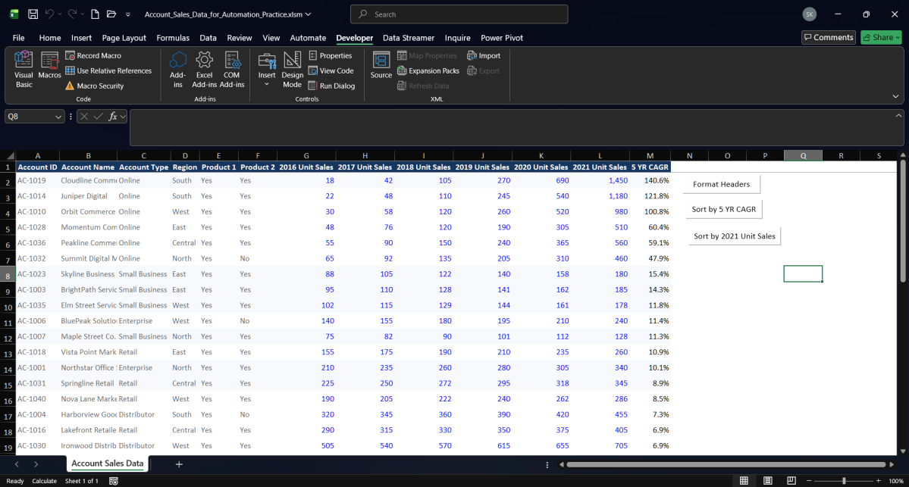

# Task 04 — Record and Run a Macro

  
  
  

---

## 🖼️ Macro Implementation Showcase

  
  
<em>Figure 1: Account Sales Data worksheet showing the Form Control buttons—including <code>Format Headers</code>—placed cleanly in column Q alongside the dataset.</em>

---

## Objective & Scope

Task 04 introduces spreadsheet automation using Microsoft Excel's built-in Macro Recorder and Visual Basic for Applications (VBA). The objective was to eliminate repetitive manual formatting by recording an initial formatting routine, verifying its generated VBA code, and binding the macro to an interactive Form Control button on the worksheet.

### Companion Workbooks & Evidence

- **Original Automation Practice Workbook:** [Account_Sales_Data_for_Automation.xlsx](../material/04-vba-and-marcos/Account_Sales_Data_for_Automation.xlsx)
- **Macro-Enabled Working Workbook:** [Account_Sales_Data_for_Automation_Practice.xlsm](../material/04-vba-and-marcos/Account_Sales_Data_for_Automation_Practice.xlsm)
- **Official Submission Evidence (PDF):** [Task_04_Macro_Buttons_Evidence.pdf](../material/04-vba-and-marcos/Task_04_Macro_Buttons_Evidence.pdf)
- **Extracted Worksheet Evidence (PNG):** [04-sorting-macro-buttons-worksheet.png](../screenshots/04-sorting-macro-buttons-worksheet.png)
- **Extracted VBA Code Evidence (PNG):** [04-vba-sorting-macro-code.png](../screenshots/04-vba-sorting-macro-code.png)

---

## 1. Initial Workbook Inspection

Before recording any actions:
1. The raw workbook `Account_Sales_Data_for_Automation.xlsx` was duplicated and saved as an **Excel Macro-Enabled Workbook (`.xlsm`)**: `Account_Sales_Data_for_Automation_Practice.xlsm`.
2. The dataset bounds were confirmed on worksheet `Account Sales Data`:
   - Header Row: `A1:M1` (13 columns: `Account ID` through `5 YR CAGR`).
   - Data Rows: `A2:M41` (40 commercial account records).
3. The Developer ribbon tab was enabled (**File → Options → Customize Ribbon → Developer**).

---

## 2. Record the Header Formatting Macro

The initial macro was recorded using Excel's Macro Recorder to standardize table header styling:

- **Macro Name:** `FormatHeaders` (or `FormatSalesHeaders`)
- **Storage Location:** `This Workbook` (stored in `Module1`)
- **Operations Recorded:**
  1. Selected header cells `A1:M1`.
  2. Applied bold font formatting (`Selection.Font.Bold = True`).
  3. Centered column alignment.
  4. Applied top and bottom cell border lines.
  5. Adjusted column widths to AutoFit data content cleanly.
  6. Stopped Macro Recording.

---

## 3. Test & Inspect Generated VBA

1. **Format Removal Test:** Cleared all header formatting via **Home → Clear → Clear Formats**.
2. **Execution Test:** Opened **Developer → Macros**, selected the formatting macro, and clicked **Run**.
3. **Validation:** Confirmed header formatting reappeared instantly across `A1:M1` without altering cell contents or underlying account records.
4. **Code Inspection:** Pressed `Alt + F11` to inspect the generated VBA code within `Module1`.

---

## 4. Bind Macro to Form Control Button

To make the macro accessible with a single click:
1. Navigated to **Developer → Insert → Form Controls → Button**.
2. Drew the button in cell `Q2:Q3` to the right of the table, avoiding data obstruction.
3. In the **Assign Macro** dialog, selected the formatting macro.
4. Labeled the button: **`Format Headers`**.
5. Clicked the button to verify instant execution.

---

## 5. Next Steps & Progressive Automation

With the initial macro recorded and bound to its Form Control button, the workflow progressed to recording descending data sorting routines:
- **`Sort by 5 YR CAGR`**
- **`Sort by 2021 Unit Sales`**

Detailed implementation and code review for the sorting macros are documented in [Task 04 — Sorting Macros and Buttons](06-sort-macros-and-buttons.md).

---

## Quality Checklist

- [x] Working copy saved as `.xlsm` to preserve VBA macros.
- [x] Initial header formatting macro recorded and tested.
- [x] Generated VBA inspected in the Visual Basic Editor (`Module1`).
- [x] Form Control button created and labeled **`Format Headers`**.
- [x] Button placement verified in column Q to avoid covering tabular data.
- [x] Full visual evidence verified in `screenshots/04-sorting-macro-buttons-worksheet.png`.
