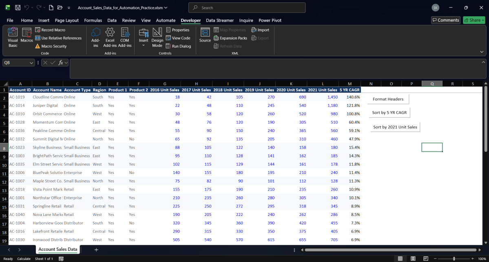
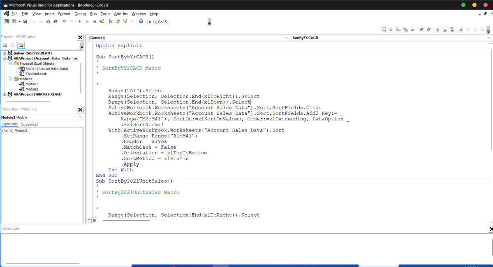

# Task 04 — Sorting Macros and Buttons

<div align="center">
  
  
  
</div>

---

## 🖼️ Official Visual Evidence Showcase

The two screenshots below were extracted directly from the official submission evidence PDF ([`Task_04_Macro_Buttons_Evidence.pdf`](../material/04-vba-and-marcos/Task_04_Macro_Buttons_Evidence.pdf)):

### 1. Worksheet View with Integrated Macro Buttons
<div align="center">
  <a href="../screenshots/04-sorting-macro-buttons-worksheet.png">
    
  </a>
  <p><em>Figure 1: Account Sales Data worksheet sorted dynamically by <code>5 YR CAGR</code> descending, featuring three Form Control buttons in column Q: <code>Format Headers</code>, <code>Sort by 5 YR CAGR</code>, and <code>Sort by 2021 Unit Sales</code>.</em></p>
</div>

### 2. VBA Code in Microsoft Visual Basic for Applications
<div align="center">
  <a href="../screenshots/04-vba-sorting-macro-code.png">
    
  </a>
  <p><em>Figure 2: Microsoft Visual Basic for Applications editor displaying <code>Module2 (Code)</code> containing procedures <code>SortBy5YrCAGR</code> and <code>SortBy2021UnitSales</code>.</em></p>
</div>

---

## Objective & Execution Summary

The core objective of this exercise was to automate repetitive multi-column tabular sorting in Microsoft Excel using recorded VBA macros bound to Form Control command buttons. This ensures stakeholders can instantly reorder the 40-account dataset by growth or volume with zero manual configuration.

- **Macro-Enabled Working File:** [Account_Sales_Data_for_Automation_Practice.xlsm](../material/04-vba-and-marcos/Account_Sales_Data_for_Automation_Practice.xlsm)
- **Original Source File:** [Account_Sales_Data_for_Automation.xlsx](../material/04-vba-and-marcos/Account_Sales_Data_for_Automation.xlsx)
- **Official Submission PDF:** [Task_04_Macro_Buttons_Evidence.pdf](../material/04-vba-and-marcos/Task_04_Macro_Buttons_Evidence.pdf)

---

## 1. Table Architecture & Relational Integrity

Before recording sorting actions, the dataset structure was verified:
- **Worksheet:** `Account Sales Data`
- **Total Range:** `A1:M41` (Headers in row 1, 40 account rows in rows 2–41)
- **Volume Field:** Column `L` (`2021 Unit Sales`)
- **Growth Field:** Column `M` (`5 YR CAGR`)

> [!CAUTION]
> **Relational Integrity Rule:** Sorting a single column alone breaks data linkage across account records. Both recorded macros explicitly select the entire table (`A1:M41`) before executing the sort, ensuring complete rows move together.

---

## 2. Implemented Sorting Macros

### Macro 1 — Sort by 5 YR CAGR (`SortBy5YrCAGR`)

- **Objective:** Rank accounts from highest compound annual growth rate to lowest.
- **Sort Key:** Column `M` (`M2:M41`)
- **Sort Order:** `xlDescending` (Largest to Smallest)
- **Header Specification:** `Header = xlYes`

### Macro 2 — Sort by 2021 Unit Sales (`SortBy2021UnitSales`)

- **Objective:** Rank accounts from highest 2021 sales volume to lowest.
- **Sort Key:** Column `L` (`L2:L41`)
- **Sort Order:** `xlDescending` (Largest to Smallest)
- **Header Specification:** `Header = xlYes`

---

## 3. Verified VBA Source Code (`Module2`)

The exact recorded VBA implementation captured in the official submission evidence:

```vba
Option Explicit

Sub SortBy5YrCAGR()
'
' SortBy5YrCAGR Macro
'

'
    Range("A1").Select
    Range(Selection, Selection.End(xlToRight)).Select
    Range(Selection, Selection.End(xlDown)).Select
    ActiveWorkbook.Worksheets("Account Sales Data").Sort.SortFields.Clear
    ActiveWorkbook.Worksheets("Account Sales Data").Sort.SortFields.Add2 Key:= _
        Range("M2:M41"), SortOn:=xlSortOnValues, Order:=xlDescending, DataOption _
        :=xlSortNormal
    With ActiveWorkbook.Worksheets("Account Sales Data").Sort
        .SetRange Range("A1:M41")
        .Header = xlYes
        .MatchCase = False
        .Orientation = xlTopToBottom
        .SortMethod = xlPinYin
        .Apply
    End With
End Sub

Sub SortBy2021UnitSales()
'
' SortBy2021UnitSales Macro
'

'
    Range("A1").Select
    Range(Selection, Selection.End(xlToRight)).Select
    Range(Selection, Selection.End(xlDown)).Select
    ActiveWorkbook.Worksheets("Account Sales Data").Sort.SortFields.Clear
    ActiveWorkbook.Worksheets("Account Sales Data").Sort.SortFields.Add2 Key:= _
        Range("L2:L41"), SortOn:=xlSortOnValues, Order:=xlDescending, DataOption _
        :=xlSortNormal
    With ActiveWorkbook.Worksheets("Account Sales Data").Sort
        .SetRange Range("A1:M41")
        .Header = xlYes
        .MatchCase = False
        .Orientation = xlTopToBottom
        .SortMethod = xlPinYin
        .Apply
    End With
End Sub
```

### Technical Code Walkthrough

1. **Dynamic Selection (`Range("A1").Select` ... `xlToRight` / `xlDown`):** Simulates keyboard navigation `Ctrl + Shift + Right` and `Ctrl + Shift + Down` to encompass the contiguous dataset.
2. **`SortFields.Clear`:** Flushes prior sorting criteria from memory to prevent conflicting multi-level sorts.
3. **`SortFields.Add2 Key:=...`:** Registers the active sort key (`M2:M41` for CAGR; `L2:L41` for 2021 Sales) with descending order.
4. **`With ... .Apply`:** Configures `.SetRange Range("A1:M41")`, designates row 1 as table headers (`.Header = xlYes`), and applies the sort.

---

## 4. Form Control Button Integration

Three standard Form Control buttons were drawn in column `Q` (`Q2:Q8`) to the right of the table:

| Button Text | Target Macro | Worksheet Location | Functionality |
|---|---|---|---|
| **Format Headers** | `FormatHeaders` | `Q2:Q3` | Applies bold styling and cell borders to headers |
| **Sort by 5 YR CAGR** | `SortBy5YrCAGR` | `Q4:Q5` | Re-sorts table descending by 5-Year CAGR |
| **Sort by 2021 Unit Sales** | `SortBy2021UnitSales` | `Q6:Q7` | Re-sorts table descending by 2021 Unit Sales |

---

## 5. Visual Results: Dynamic Sorting by 5 YR CAGR

When `Sort by 5 YR CAGR` is clicked, the table dynamically reorders with top growth accounts leading the portfolio:

| Rank | Account ID | Account Name | Account Type | Region | 2021 Sales | 5 YR CAGR |
|:---:|---|---|---|---|---:|---:|
| 1 | `AC-1019` | Cloudline Commerce | Online | South | 1,450 | **140.6%** |
| 2 | `AC-1014` | Juniper Digital | Online | South | 1,180 | **121.8%** |
| 3 | `AC-1010` | Orbit Commerce | Online | West | 980 | **100.8%** |
| 4 | `AC-1028` | Momentum Commerce | Online | East | 510 | **60.4%** |
| 5 | `AC-1036` | Peakline Commerce | Online | Central | 560 | **59.1%** |
| 6 | `AC-1032` | Summit Digital Media | Online | North | 460 | **47.9%** |
| 7 | `AC-1023` | Skyline Business | Small Business | East | 180 | **15.4%** |
| 8 | `AC-1003` | BrightPath Services | Small Business | East | 185 | **14.3%** |
| 9 | `AC-1035` | Elm Street Services | Small Business | West | 178 | **11.8%** |
| 10 | `AC-1006` | BluePeak Solutions | Enterprise | West | 240 | **11.4%** |

*Observation:* The top six growth leaders all belong to the **Online** segment, highlighting e-commerce as the primary engine of high-velocity growth.

---

## 6. Official Submission & Evidence Quality Check

- [x] Initial header formatting macro recorded and bound to button `Format Headers`.
- [x] `SortBy5YrCAGR` recorded and bound to button `Sort by 5 YR CAGR`.
- [x] `SortBy2021UnitSales` recorded and bound to button `Sort by 2021 Unit Sales`.
- [x] Both sort routines verified independently for seamless one-click execution.
- [x] Workbook screenshot showing all three buttons captured.
- [x] VBA code screenshot showing `SortBy5YrCAGR` and `SortBy2021UnitSales` captured.
- [x] Evidence assembled into `Task_04_Macro_Buttons_Evidence.pdf`.
- [x] Workbook (`.xlsm`) and PDF evidence uploaded and submitted to Forage.
- [x] Completion confirmed on **November 4, 2026**.
