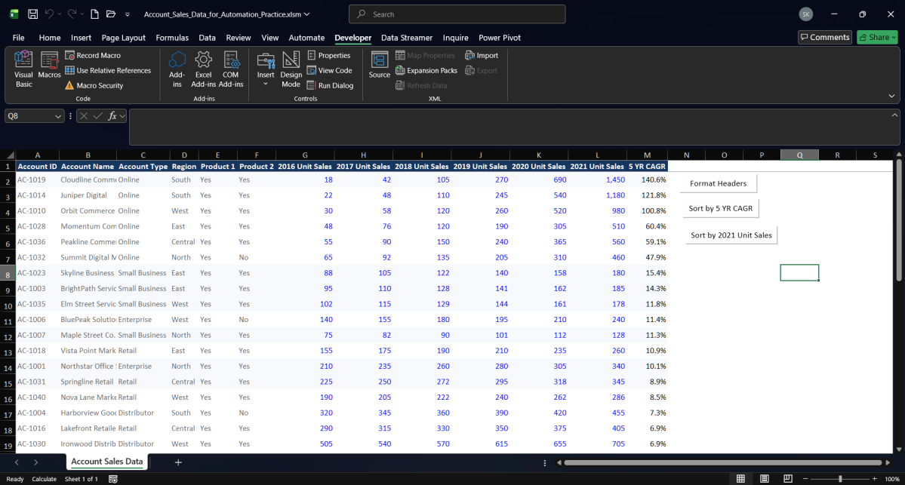
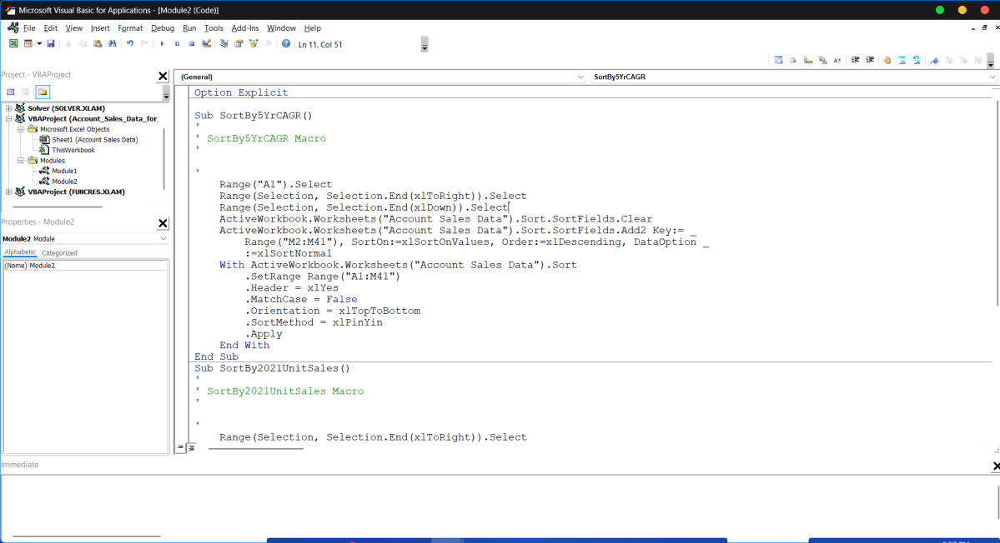

# Automation and VBA — Technical Notes & Code Reference

<div align="center">
  
  
</div>

---

## 🖼️ Official Visual Evidence Showcase

The screenshots below are extracted directly from the official submission evidence PDF ([`Task_04_Macro_Buttons_Evidence.pdf`](../material/04-vba-and-marcos/Task_04_Macro_Buttons_Evidence.pdf)):

### 1. Worksheet with Form Control Buttons
<div align="center">
  <a href="../screenshots/04-sorting-macro-buttons-worksheet.png">
    
  </a>
  <p><em>Figure 1: Form Control buttons (<code>Format Headers</code>, <code>Sort by 5 YR CAGR</code>, and <code>Sort by 2021 Unit Sales</code>) positioned adjacent to the account dataset.</em></p>
</div>

### 2. VBA Code in Visual Basic Editor
<div align="center">
  <a href="../screenshots/04-vba-sorting-macro-code.png">
    
  </a>
  <p><em>Figure 2: Module2 code displaying <code>SortBy5YrCAGR</code> and <code>SortBy2021UnitSales</code> procedures in Microsoft Visual Basic for Applications.</em></p>
</div>

---

## 1. Automation Workflow in Task 04

Spreadsheet automation in Task 04 bridges beginner Macro Recorder usage with production VBA code structure:

1. **Header Formatting (`Module1`):**
   - Routine `FormatHeaders` applies bold weight, centered alignment, and AutoFit column dimensions to headers `A1:M1`.
   - Bound to button **`[Format Headers]`** in cell `Q2:Q3`.
2. **Growth Rate Sorting (`Module2`):**
   - Routine `SortBy5YrCAGR` sorts range `A1:M41` descending by `5 YR CAGR` (column `M`).
   - Bound to button **`[Sort by 5 YR CAGR]`** in cell `Q4:Q5`.
3. **Volume Sorting (`Module2`):**
   - Routine `SortBy2021UnitSales` sorts range `A1:M41` descending by `2021 Unit Sales` (column `L`).
   - Bound to button **`[Sort by 2021 Unit Sales]`** in cell `Q6:Q7`.

---

## 2. VBA Code Architecture & Analysis

```vba
Option Explicit

Sub SortBy5YrCAGR()
'
' SortBy5YrCAGR Macro
'
    Range("A1").Select
    Range(Selection, Selection.End(xlToRight)).Select
    Range(Selection, Selection.End(xlDown)).Select
    ActiveWorkbook.Worksheets("Account Sales Data").Sort.SortFields.Clear
    ActiveWorkbook.Worksheets("Account Sales Data").Sort.SortFields.Add2 Key:= _
        Range("M2:M41"), SortOn:=xlSortOnValues, Order:=xlDescending, DataOption _
        :=xlSortNormal
    With ActiveWorkbook.Worksheets("Account Sales Data").Sort
        .SetRange Range("A1:M41")
        .Header = xlYes
        .MatchCase = False
        .Orientation = xlTopToBottom
        .SortMethod = xlPinYin
        .Apply
    End With
End Sub

Sub SortBy2021UnitSales()
'
' SortBy2021UnitSales Macro
'
    Range("A1").Select
    Range(Selection, Selection.End(xlToRight)).Select
    Range(Selection, Selection.End(xlDown)).Select
    ActiveWorkbook.Worksheets("Account Sales Data").Sort.SortFields.Clear
    ActiveWorkbook.Worksheets("Account Sales Data").Sort.SortFields.Add2 Key:= _
        Range("L2:L41"), SortOn:=xlSortOnValues, Order:=xlDescending, DataOption _
        :=xlSortNormal
    With ActiveWorkbook.Worksheets("Account Sales Data").Sort
        .SetRange Range("A1:M41")
        .Header = xlYes
        .MatchCase = False
        .Orientation = xlTopToBottom
        .SortMethod = xlPinYin
        .Apply
    End With
End Sub
```

### Key Engineering Takeaways

- **Explicit Scoping:** Clearing prior sort fields (`SortFields.Clear`) prevents residual sort criteria from corrupting subsequent single-key operations.
- **Relational Integrity:** `.SetRange Range("A1:M41")` ensures that row records are preserved as unified relational tuples, preventing disjointed data columns.
- **Form Controls vs. ActiveX:** Form Control buttons are native Excel objects offering maximum cross-version compatibility without requiring ActiveX security elevation.

---

## 3. Companion Automation Files

- **Macro Working Workbook:** [Account_Sales_Data_for_Automation_Practice.xlsm](../material/04-vba-and-marcos/Account_Sales_Data_for_Automation_Practice.xlsm)
- **Official Submission PDF:** [Task_04_Macro_Buttons_Evidence.pdf](../material/04-vba-and-marcos/Task_04_Macro_Buttons_Evidence.pdf)
- **Task 03 Dashboard VBA Module:** [DashboardAppStyle.bas](../material/03-build-charts-and-dashboards/DashboardAppStyle.bas)
- **Task 03 Web Office Scripts:** [DashboardAppStyle_Web.ts](../material/03-build-charts-and-dashboards/DashboardAppStyle_Web.ts)
