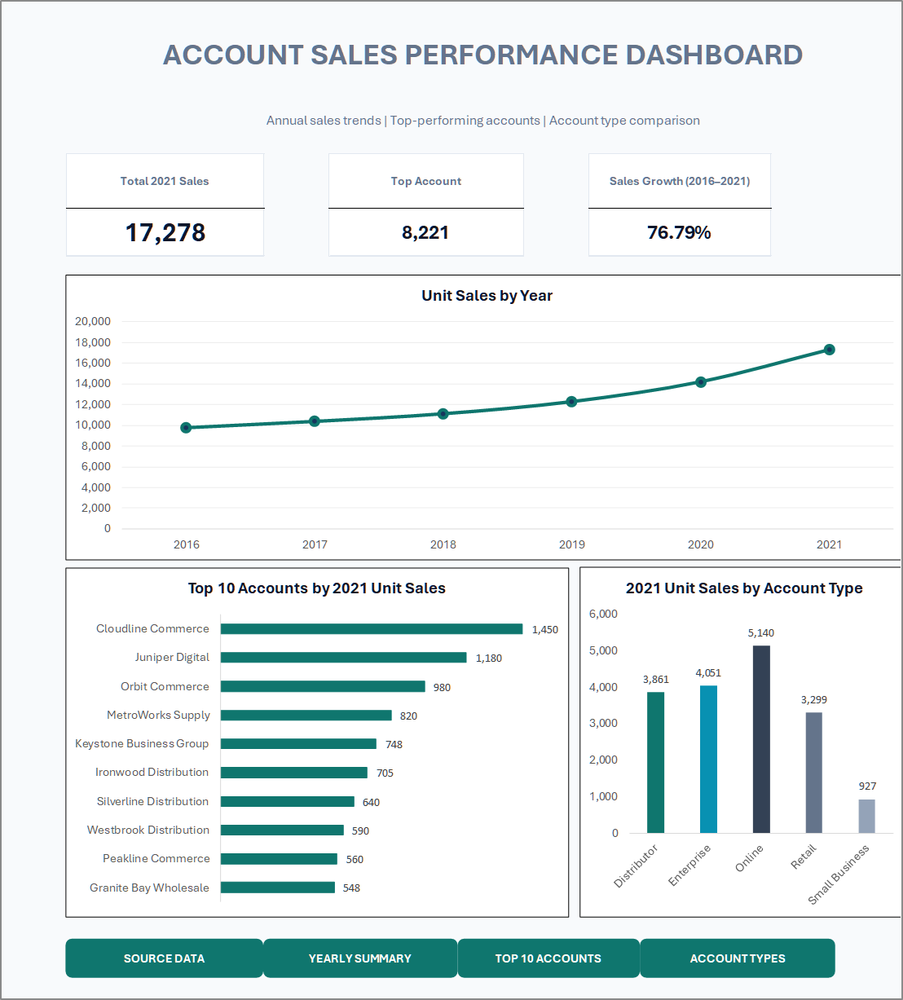

# Charts and Dashboards — Learning Notes & Architecture

  
  

---

## 🖼️ Dashboard Artifact Showcase

  
  
<em>Figure 1: Executive Account Sales Performance Dashboard combining KPI scorecards, multi-year sales velocity, account rankings, segment shares, and navigation controls.</em>

---

## 1. Visual Hierarchy & Cognitive Load Design

Effective analytics dashboards must communicate high-signal business insights within seconds. The design follows three core visualization principles:

1. **Top-Level KPI Scorecards:** Headline numbers give senior leadership immediate operational awareness before diving into exploratory charts.
2. **Temporal Context (Line Chart):** Provides macro-level trajectory over the 6-year operational horizon (2016–2021).
3. **Cross-Sectional Breakdown (Bar & Column Charts):** Delivers micro-level diagnostics by ranking individual account performance alongside industry segment volume.

---

## 2. Quantitative Summary & Data Sources

### Headline KPI Scorecards

| KPI Card | Displayed Value | Mathematical Formula / Source | Analytical Significance |
|---|---:|---|---|
| **Total 2021 Sales** | **17,278** | `=PT_Sales_by_Type!$B$7` | Full portfolio annual unit sales |
| **Top Account (Top 10 Total)** | **8,221** | `=PT_Top10_2021!$B$12` | Combined volume of the 10 largest accounts (47.58% concentration) |
| **Sales Growth (2016–2021)** | **76.79%** | `=(B7-B2)/B2` on `Annual_Sales_Summary` | Multi-year expansion (+7,505 units added since 2016) |

### Visual Breakdown

1. **Unit Sales by Year (Line Chart):**
   - Rises consistently from 9,773 units (2016) to 17,278 units (2021).
   - Growth accelerates strongly in 2020 (+15.55%) and 2021 (+21.74%).
2. **Top 10 Accounts by 2021 Unit Sales (Horizontal Bar Chart):**
   - **Cloudline Commerce** ranks #1 at 1,450 units.
   - **Juniper Digital** ranks #2 at 1,180 units.
   - **Orbit Commerce** ranks #3 at 980 units.
   - The top 3 accounts alone deliver 3,610 units (20.89% of all company sales).
3. **2021 Unit Sales by Account Type (Column Chart):**
   - **Online** leads at 5,140 units (29.75%).
   - **Enterprise** follows at 4,051 units (23.45%).
   - **Distributor** accounts for 3,861 units (22.35%).
   - **Retail** delivers 3,299 units (19.09%).
   - **Small Business** accounts for 927 units (5.36%).

---

## 3. Key Technical Takeaways

- **Excel Tables over Cell Ranges:** Tables provide structured references (e.g. `AccountSales[2021 Unit Sales]`), ensuring PivotTables dynamically capture new data.
- **PivotTable Separation:** Storing calculation PivotTables on separate dedicated sheets (`PT_Sales_by_Type`, `PT_Top10_2021`, `Annual_Sales_Summary`) keeps the `Dashboard` worksheet clean and focused exclusively on presentation.
- **Horizontal Bar Selection for Rankings:** Category names like *Keystone Business Group* or *Granite Bay Wholesale* require horizontal orientation to maintain 100% legibility without angled text.

---

## Associated Project Files

- **Working Workbook:** [Account_Sales_Data_for_Dashboard_Practice_Working.xlsx](../material/03-build-charts-and-dashboards/Account_Sales_Data_for_Dashboard_Practice_Working.xlsx)
- **App-Style XLSM Workbook:** [Account_Sales_Dashboard_AppStyle.xlsm](../material/03-build-charts-and-dashboards/Account_Sales_Dashboard_AppStyle.xlsm)
- **Exported Presentation PDF:** [Dashboard_Dashboard_20261104_221720.pdf](../material/03-build-charts-and-dashboards/Dashboard_Dashboard_20261104_221720.pdf)
- **Detailed Design Guide:** [Task 03 — Charts and Dashboard Preparation](../docs/03-chart-and-dashboard-preparation.md)
